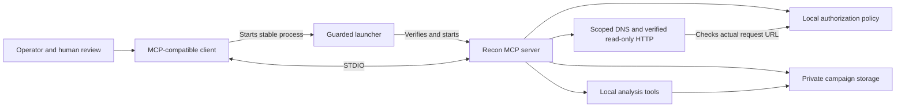

# Recon MCP

Recon MCP is a local Model Context Protocol server for authorized, human-led reconnaissance and security evidence management. It gives application security engineers, developers, students, and bug bounty researchers a way to check scope, review artifacts, and organize observations through a compatible AI client.

- **Check scope before any request.** Evaluate complete URLs against reviewed manual rules, a local HackerOne snapshot, or a supported subset of Burp Advanced Scope.
- **Collect bounded HTTP observations.** Review headers, robots directives, sitemaps, and script references using read-only requests.
- **Analyze existing material.** Inspect local JavaScript, source maps, and API contract signals. Import summaries of existing HAR, Burp XML, or DirFuzz evidence.
- **Organize research.** Use campaigns to keep scope decisions, artifacts, provenance, negative results, and finding candidates together. Review passive discovery and comparison results as leads.
- **Prepare local reports.** Track manual validation and draft Markdown summaries for human review.

Recon MCP has a deliberately narrow role. Vulnerability scanning, directory brute forcing, credential testing, autonomous exploitation, and general-purpose agent execution are outside its toolset.

## Quick start

1. On the qualified Fedora platform, follow the [stable installation](docs/installation.md#qualified-stable-fedora-installation). Contributors can use a separate [editable checkout](docs/installation.md#development-installation).
2. Register the local STDIO server using the [client setup guide](docs/client-setup.md).
3. Call `health` with `{}`. The stable release reports `ok: true`, `version: "0.2.0"`, and 67 available server tools. With no policy installed, the server runs with empty, deny-all scope.
4. Follow the [offline tutorial](docs/getting-started.md) to evaluate an allowed and a denied synthetic URL without DNS or HTTP.

## Architecture

The launcher applies to stable deployments. Client prompts, tool approvals, and hosted data handling belong to the client. See [Security design](docs/security-design.md).

## Documentation

| I want to | Guide |
| --- | --- |
| Install and run an offline diagnostic | [Getting started](docs/getting-started.md) · [Installation](docs/installation.md) |
| Connect Codex, Antigravity, Gemini CLI, or a generic client | [Client setup](docs/client-setup.md) |
| Review, test, or replace a scope policy | [Scope authorization](docs/scope-authorization.md) |
| Find a tool and understand its effects | [Tool reference](docs/tool-reference.md) |
| Organize campaigns, evidence, and reports | [Campaigns](docs/campaigns.md) · [Workflows](docs/workflows.md) · [Evidence management](docs/evidence-management.md) |
| Bring in output from another tool | [Integrations](docs/integrations.md) |
| Diagnose errors or maintain a stable deployment | [Troubleshooting](docs/troubleshooting.md) · [Deployment](docs/deployment.md) |
| Check release evidence or contribute | [Documentation index](docs/README.md) · [Contributing](CONTRIBUTING.md) · [Security reporting](SECURITY.md) |

## Compatibility and security boundaries

The v0.2.0 release was independently qualified on Fedora Linux 45 x86_64 with GIL-enabled CPython 3.15.2, direct MCP STDIO, and an offline Codex CLI 0.171.0 session with no model turn. Antigravity connectivity, 67-tool discovery, and offline diagnostics were operator-reported. Standalone Gemini CLI configuration is documented and unverified. See the [compatibility matrix](docs/compatibility.md) for the filesystem and client evidence.

Recon MCP defaults to deny and checks the actual URL of each network request, redirect, and fallback. Public DNS answers are checked before a connection to a validated numeric address. The authorized hostname is retained for TLS verification. Credential-like and ambiguous URLs are rejected before DNS, and recognizable credentials are redacted in supported diagnostics. Raw evidence can still contain sensitive data. The operator confirms real-world permission, reviews tool results, and decides whether a finding is ready to report. [Scope authorization](docs/scope-authorization.md) · [Security design](docs/security-design.md)

## Release

[Published v0.2.0 release](https://github.com/tobiasGuta/recon-mcp/releases/tag/v0.2.0) · [Changelog](CHANGELOG.md) · [Release preparation and qualification](docs/v0.2.0-release-preparation.md#qualification-and-release-status) · [Historical records](docs/README.md#release-and-engineering-records)

## Available Python MCP Tools

See the [complete tool reference](docs/tool-reference.md) for parameters, return values, and effects.

Show all 67 registered tool signatures

- `health()` · [reference](docs/tool-reference.md#health)
- `check_scope(domain: str)` · [reference](docs/tool-reference.md#check_scope)
- `resolve_scope_target(host_or_url: str, format: str | None = None)` · [reference](docs/tool-reference.md#resolve_scope_target)
- `check_scope_batch(hosts_or_urls: list[str], format: str | None = None)` · [reference](docs/tool-reference.md#check_scope_batch)
- `get_scope_map()` · [reference](docs/tool-reference.md#get_scope_map)
- `recommend_bugmap_parent(host_or_url: str, available_bugmap_targets: list[dict])` · [reference](docs/tool-reference.md#recommend_bugmap_parent)
- `explain_scope_decision(host_or_url: str)` · [reference](docs/tool-reference.md#explain_scope_decision)
- `list_loaded_scope()` · [reference](docs/tool-reference.md#list_loaded_scope)
- `validate_scope_policy()` · [reference](docs/tool-reference.md#validate_scope_policy)
- `check_url_scope(url: str)` · [reference](docs/tool-reference.md#check_url_scope)
- `check_url_scope_batch(urls: list[str])` · [reference](docs/tool-reference.md#check_url_scope_batch)
- `get_scope_policy_summary()` · [reference](docs/tool-reference.md#get_scope_policy_summary)
- `compare_scope_policies(before: str, after: str)` · [reference](docs/tool-reference.md#compare_scope_policies)
- `get_scope_capabilities()` · [reference](docs/tool-reference.md#get_scope_capabilities)
- `fetch_headers(url: str)` · [reference](docs/tool-reference.md#fetch_headers)
- `fetch_robots(url: str)` · [reference](docs/tool-reference.md#fetch_robots)
- `fetch_sitemap(url: str)` · [reference](docs/tool-reference.md#fetch_sitemap)
- `collect_js_urls(url: str)` · [reference](docs/tool-reference.md#collect_js_urls)
- `extract_endpoints_from_js(file_or_url: str, source_type: str | None = None)` · [reference](docs/tool-reference.md#extract_endpoints_from_js)
- `dedupe_urls(urls: list[str])` · [reference](docs/tool-reference.md#dedupe_urls)
- `create_evidence_note(finding: dict)` · [reference](docs/tool-reference.md#create_evidence_note)
- `generate_manual_test_plan(target_summary: dict)` · [reference](docs/tool-reference.md#generate_manual_test_plan)
- `dirfuzz_integration_info()` · [reference](docs/tool-reference.md#dirfuzz_integration_info)
- `create_campaign(program: str, target: str, notes: str | None = None)` · [reference](docs/tool-reference.md#create_campaign)
- `list_campaigns(limit: int = 50)` · [reference](docs/tool-reference.md#list_campaigns)
- `get_campaign(campaign_id: str)` · [reference](docs/tool-reference.md#get_campaign)
- `archive_campaign(campaign_id: str, reason: str | None = None)` · [reference](docs/tool-reference.md#archive_campaign)
- `list_archived_campaigns(limit: int = 50)` · [reference](docs/tool-reference.md#list_archived_campaigns)
- `get_archived_campaign(campaign_id: str)` · [reference](docs/tool-reference.md#get_archived_campaign)
- `delete_archived_campaign(campaign_id: str, confirm_campaign_id: str)` · [reference](docs/tool-reference.md#delete_archived_campaign)
- `fetch_headers_for_campaign(campaign_id: str, url: str)` · [reference](docs/tool-reference.md#fetch_headers_for_campaign)
- `fetch_robots_for_campaign(campaign_id: str, url: str)` · [reference](docs/tool-reference.md#fetch_robots_for_campaign)
- `fetch_sitemap_for_campaign(campaign_id: str, url: str)` · [reference](docs/tool-reference.md#fetch_sitemap_for_campaign)
- `collect_js_urls_for_campaign(campaign_id: str, url: str)` · [reference](docs/tool-reference.md#collect_js_urls_for_campaign)
- `extract_endpoints_for_campaign(campaign_id: str, file_or_url: str, source_type: str | None = None)` · [reference](docs/tool-reference.md#extract_endpoints_for_campaign)
- `save_dirfuzz_analysis_for_campaign(campaign_id: str, analysis: dict)` · [reference](docs/tool-reference.md#save_dirfuzz_analysis_for_campaign)
- `create_finding_candidate(campaign_id: str, finding: dict)` · [reference](docs/tool-reference.md#create_finding_candidate)
- `get_finding(campaign_id: str, finding_id: str)` · [reference](docs/tool-reference.md#get_finding)
- `list_findings(campaign_id: str, status: str | None = None)` · [reference](docs/tool-reference.md#list_findings)
- `promote_finding(campaign_id: str, finding_id: str, target_status: str, reason: str, gate_updates: dict | None = None)` · [reference](docs/tool-reference.md#promote_finding)
- `demote_finding(campaign_id: str, finding_id: str, target_status: str, reason: str)` · [reference](docs/tool-reference.md#demote_finding)
- `reject_finding(campaign_id: str, finding_id: str, reason: str)` · [reference](docs/tool-reference.md#reject_finding)
- `create_campaign_evidence_note(campaign_id: str, finding: dict)` · [reference](docs/tool-reference.md#create_campaign_evidence_note)
- `score_endpoint(endpoint: dict | str)` · [reference](docs/tool-reference.md#score_endpoint)
- `score_endpoints(endpoints: list[dict | str])` · [reference](docs/tool-reference.md#score_endpoints)
- `record_negative_result(campaign_id: str, target: str, check_type: str, result: str, repeat_after: str | None = None, metadata: dict | None = None)` · [reference](docs/tool-reference.md#record_negative_result)
- `list_negative_results(campaign_id: str, check_type: str | None = None)` · [reference](docs/tool-reference.md#list_negative_results)
- `generate_manual_test_plan_for_campaign(campaign_id: str)` · [reference](docs/tool-reference.md#generate_manual_test_plan_for_campaign)
- `generate_campaign_summary(campaign_id: str)` · [reference](docs/tool-reference.md#generate_campaign_summary)
- `generate_report_candidate_markdown(campaign_id: str, finding_id: str)` · [reference](docs/tool-reference.md#generate_report_candidate_markdown)
- `detect_sourcemap_references_for_campaign(campaign_id: str, js_url: str)` · [reference](docs/tool-reference.md#detect_sourcemap_references_for_campaign)
- `download_sourcemap_for_campaign(campaign_id: str, sourcemap_url: str)` · [reference](docs/tool-reference.md#download_sourcemap_for_campaign)
- `extract_sourcemap_sources_for_campaign(campaign_id: str, map_path: str)` · [reference](docs/tool-reference.md#extract_sourcemap_sources_for_campaign)
- `analyze_sourcemap_sources_for_campaign(campaign_id: str, extracted_dir: str | None = None)` · [reference](docs/tool-reference.md#analyze_sourcemap_sources_for_campaign)
- `sourcemap_workflow_for_campaign(campaign_id: str, js_url: str)` · [reference](docs/tool-reference.md#sourcemap_workflow_for_campaign)
- `external_sourcemapper_info()` · [reference](docs/tool-reference.md#external_sourcemapper_info)
- `scan_sensitive_artifacts_for_campaign(campaign_id: str, extracted_dir: str | None = None)` · [reference](docs/tool-reference.md#scan_sensitive_artifacts_for_campaign)
- `extract_api_contracts_for_campaign(campaign_id: str, extracted_dir: str | None = None)` · [reference](docs/tool-reference.md#extract_api_contracts_for_campaign)
- `get_evidence_graph_summary(campaign_id: str)` · [reference](docs/tool-reference.md#get_evidence_graph_summary)
- `query_evidence_graph(campaign_id: str, node_uuid: str, depth: int = 1, limit: int = 100)` · [reference](docs/tool-reference.md#query_evidence_graph)
- `import_dirfuzz_evidence_for_campaign(campaign_id: str, analysis_path: str | None = None)` · [reference](docs/tool-reference.md#import_dirfuzz_evidence_for_campaign)
- `discover_subdomains_passive_for_campaign(campaign_id: str, root_domain: str, providers: list[str] | None = None, max_results: int = 500, resolve_dns: bool = False)` · [reference](docs/tool-reference.md#discover_subdomains_passive_for_campaign)
- `compare_campaign_recon(campaign_id: str, baseline_campaign_id: str)` · [reference](docs/tool-reference.md#compare_campaign_recon)
- `import_har_for_campaign(campaign_id: str, har_path: str)` · [reference](docs/tool-reference.md#import_har_for_campaign)
- `import_burp_xml_for_campaign(campaign_id: str, xml_path: str)` · [reference](docs/tool-reference.md#import_burp_xml_for_campaign)
- `verify_campaign_artifacts(campaign_id: str)` · [reference](docs/tool-reference.md#verify_campaign_artifacts)
- `nuclei_integration_info()` · [reference](docs/tool-reference.md#nuclei_integration_info)

