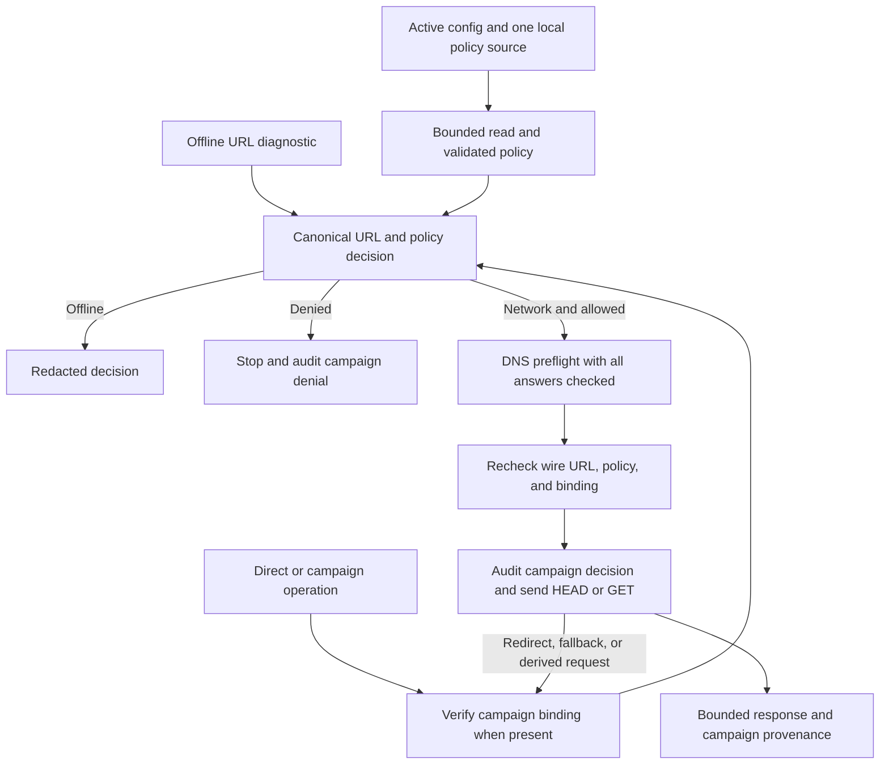

# Recon MCP v0.2.0 engineering report

This report records the initial qualification before independent audit remediation. See the [final qualification report](v0.2.0-final-qualification-report.md) for the current transport, storage guarantees, and re-audit status.

## Executive summary

Recon MCP now authorizes complete HTTP(S) URLs against one local policy before DNS and again before dispatch. All existing network paths use the shared transport and policy engine. An operator can review manual, H1 snapshot, or Burp Advanced Scope decisions offline and bind a campaign to a reviewed policy. The branch contains a local release candidate. Release review remains pending.

## Initial audit

The starting checkout was clean on `main` at `f8e4c80`. Python 3.15.2 and MCP SDK 1.30.0 were installed in `.venv`. The baseline suite passed all 157 tests. The project already used STDIO, bounded streamed reads, defused XML parsing, request delays, DNS safety checks, local evidence storage, and per-artifact SHA-256 sidecars.

| Area | Initial finding | Correction |
| --- | --- | --- |
| Scope resolution | `scope.py` and `h1_scope.py` projected URLs onto hostnames. Legacy H1 fallback could describe children of an exact asset as in scope. A permissive wildcard could hide a narrower H1 entry filtered out of the inventory. | URL authorization retains supported constraints and treats ineligible H1 entries as exclusions. An H1 directory with several programs requires explicit selection for URL authorization. Host inventory retains evidence labels and never permits network execution. |
| HTTP dispatch | The shared request loop authorized only host membership. Redirect preflight resolved the next host before checking scope. Derived origin paths and fallback GETs used hostname-only authorization. | Strict canonical URLs, exact wire-target checks, policy before DNS, public-address checks, post-DNS policy verification, and re-evaluation for every redirect and fallback. |
| JavaScript and maps | The JavaScript collector treated same-origin candidates as in scope. Relative script and map references used the submitted URL, even after a redirect. Map discovery could classify a host as downloadable despite path restrictions. | Evaluate complete candidate URLs against the shared engine, resolve relative references from the final response URL, and check the actual download again at dispatch. |
| Passive discovery | Provider requests used a separate HTTP client. Optional DNS submitted discovered names without requiring individual URL authorization. A wildcard could authorize a provider query for its apex. | Authorize the root's HTTPS URL and each actual provider URL. Optional DNS applies only to individually authorized HTTPS root URLs. Provider redirects stay disabled. |
| Freshness and file access | A process-local cache could retain a permissive policy for 30 seconds after replacement or invalidation. Snapshot and config readers had uneven bounds and file checks. | Fresh bounded reads, duplicate-key rejection, full validation before use, and checks for changed files or snapshot sets. Linux uses descriptor-relative policy reads to reject symlink traversal. |
| Campaigns and evidence | Campaign creation saved descriptive host-scope metadata. A later operation could fetch before establishing a current campaign binding. The historical scope hash did not identify the current decision. | Bind an authorized URL and policy fingerprint, recheck for network operations, audit dispatch and denials, and attach current policy provenance to existing artifacts and sidecars. |
| Logging and HTTP client | Request and error surfaces could carry URL values into records. The default HTTPX client could use environment proxies or retain response cookies across manual hops. | Redacted authorization and request provenance, credential-like URL rejection, cookie stripping, HTTPX URL logging disabled at STDIO startup, and environment proxy discovery disabled. |

### Initial MCP tool inventory

The 61 original tools remain registered.

| Kind | Tools |
| --- | --- |
| Health and scope | `health`, `check_scope`, `resolve_scope_target`, `check_scope_batch`, `get_scope_map`, `recommend_bugmap_parent`, `explain_scope_decision`, `list_loaded_scope` |
| Direct network inputs | `fetch_headers`, `fetch_robots`, `fetch_sitemap`, `collect_js_urls`, `extract_endpoints_from_js` in URL mode |
| Campaign network inputs | `fetch_headers_for_campaign`, `fetch_robots_for_campaign`, `fetch_sitemap_for_campaign`, `collect_js_urls_for_campaign`, `extract_endpoints_for_campaign` in URL mode, `detect_sourcemap_references_for_campaign`, `download_sourcemap_for_campaign`, `sourcemap_workflow_for_campaign`, `discover_subdomains_passive_for_campaign` |
| Offline evidence, analysis, and reports | `dedupe_urls`, `create_evidence_note`, `generate_manual_test_plan`, `save_dirfuzz_analysis_for_campaign`, `create_campaign_evidence_note`, `score_endpoint`, `score_endpoints`, `generate_manual_test_plan_for_campaign`, `generate_campaign_summary`, `generate_report_candidate_markdown`, `extract_sourcemap_sources_for_campaign`, `analyze_sourcemap_sources_for_campaign`, `scan_sensitive_artifacts_for_campaign`, `extract_api_contracts_for_campaign`, `get_evidence_graph_summary`, `query_evidence_graph`, `import_dirfuzz_evidence_for_campaign`, `compare_campaign_recon`, `import_har_for_campaign`, `import_burp_xml_for_campaign`, `verify_campaign_artifacts` |
| Campaign storage | `create_campaign`, `list_campaigns`, `get_campaign`, `archive_campaign`, `list_archived_campaigns`, `get_archived_campaign`, `delete_archived_campaign` |
| Findings and memory | `create_finding_candidate`, `get_finding`, `list_findings`, `promote_finding`, `demote_finding`, `reject_finding`, `record_negative_result`, `list_negative_results` |
| Integration metadata | `dirfuzz_integration_info`, `external_sourcemapper_info`, `nuclei_integration_info` |

## Authorization architecture



The implementation followed the dependency order of local policy parsing and matching, transport enforcement, campaign binding and provenance, and offline diagnostics and verification. A campaign's original `scope.json` stays intact during local reauthorization, so historical artifact references retain their meaning.

## Tools and configuration

| New tool | Input properties | Output |
| --- | --- | --- |
| `validate_scope_policy` | None | Validity, readiness, rule counts and descriptors, fingerprint, warnings, and configuration errors. |
| `check_url_scope` | Required `url` string | One redacted authorization decision with normalized components, applicable rule IDs, policy provenance, and reason. |
| `check_url_scope_batch` | Required `urls` array of strings | Bounded decisions sharing one policy fingerprint. |
| `get_scope_policy_summary` | None | Supported constraints, rule counts, fingerprint, and known limitations. |
| `compare_scope_policies` | Required `before` and `after` local policy names | Rule differences, possible direction of authorization changes, and the comparison's certainty. |
| `get_scope_capabilities` | None | Source capabilities, limitations, and resource bounds. |

All six publish an MCP object output schema and read-only annotations. The [scope authorization guide](scope-authorization.md) specifies the response fields and reason codes, manual and H1 configuration examples, comparison rules, CLI behavior, and the Gemini allowlist. [The Burp export example](../config/burp-scope.example.json) exercises HTTPS, effective port 443, an exact synthetic hostname, a path prefix, and a narrower exclusion.

## Files

| Area | Added | Modified |
| --- | --- | --- |
| Policy and entry points | `recon/authorization.py`, `recon/policy_io.py`, `recon/scope_cli.py` | `recon/scope.py`, `recon/h1_scope.py`, `server.py`, `pyproject.toml`, `recon/__init__.py` |
| Transport and authorization callers |  | `recon/http_fetch.py`, `recon/js_analysis.py`, `recon/passive.py`, `recon/sourcemaps.py`, `recon/workflow.py` |
| Campaign and evidence | `recon/campaign_scope.py` | `recon/campaigns.py`, `recon/audit.py`, `recon/redaction.py`, `recon/safeio.py` |
| Tests | `tests/test_authorization.py`, `tests/test_authorization_enforcement.py`, `tests/test_scope_stdio.py` | `tests/conftest.py`, `tests/test_h1_scope.py`, `tests/test_http_safety.py`, `tests/test_js_analysis.py`, `tests/test_scope.py`, `tests/test_scope_config.py` |
| Configuration and guides | `config/burp-scope.example.json`, `docs/scope-authorization.md`, `docs/v0.2.0-engineering-report.md` | `.gitignore`, `config/scope.example.json`, `README.md`, `docs/security-design.md` |

The package advertises version 0.2.0 and retains `mcp>=1.0.0,<2.0.0`. IDNA is an explicit dependency because the canonicalizer uses it directly. Existing installation commands and the `server.py` STDIO entry point still work.

## Qualification and compatibility

- Baseline on `main`: 157 passed. Qualification on the feature branch: 286 passed, including all 157 original tests with the intentional adjustments below.
- `pip check` reported no broken requirements. Import and bare server startup with EOF succeeded. The MCP 1.30.0 STDIO client initialized against the launched server, discovered all 67 tools, verified the six diagnostic schemas, and called all six.
- Test fixtures use synthetic policies, temporary campaign storage, and mock HTTP and DNS. Regression tests confirm excluded, ambiguous, and stale requests never reach the mock HTTP transport. Offline tests fail if they attempt DNS or socket connections.
- JSONL append was exercised by three independent processes writing 90 records total on local POSIX storage. The existing artifact verification suite and campaign reauthorization tests checked historical evidence.
- The cache test now requires immediate configuration edits. The host-only interop test expects `can_scan` and `can_test` to be false. The IDN full-URL test now expects the centralized `allowed` code. The unsafe redirect test adds explicit authorization for its test host so DNS safety is exercised after the URL check. JavaScript mocks provide the final URL and fingerprint. The suite isolates the default policy so it does not use the operator's active configuration.

### Local verification commands

Run from the repository root on Linux. Windows installation and equivalent interpreter paths are in the [README](../README.md#installation).

```bash
.venv/bin/python -m pytest
.venv/bin/python -m pip check
.venv/bin/python -c 'from importlib.metadata import version; import server; print(version("recon-mcp"), version("mcp"), len(server.AVAILABLE_TOOLS))'
.venv/bin/python server.py </dev/null
.venv/bin/python -m pytest -q tests/test_scope_stdio.py tests/test_authorization.py tests/test_authorization_enforcement.py
.venv/bin/python -m recon.scope_cli validate --config config/scope.example.json
.venv/bin/python -m recon.scope_cli check https://api.example.com/ --config config/scope.example.json
git diff --check
git status --short --branch
```

## Limitations and release review

| Status | Item |
| --- | --- |
| Implemented and tested | All network entry-point authorization, configured exclusions, bounded offline diagnostics, policy freshness on read, campaign binding and local reauthorization, and audit and artifact provenance. |
| Deliberately limited | Anchored Burp regex compatibility, exact raw query support, fail-closed handling of unknown H1 fields and types, and indeterminate comparison when canonical fingerprints differ. Existing URL-form H1 assets and manual entries are deliberately narrower at dispatch. |
| Unverified | Native Burp application replay parity, Windows execution, actual Codex and Gemini client configuration, live H1 releases, and MCP 1.x versions other than 1.30.0. Verification used the SDK's real STDIO client and local policy fixtures. |
| Remaining limitation | DNS answers are checked before the HTTP client's independent connection-time resolution. This was the pre-remediation transport. The subsequent audit remediation adds numeric pinning at dispatch. Local free-text program restrictions and upstream snapshot completeness require human review. |
| Remaining limitation | The initial implementation relied on an advisory single-writer rule. The subsequent audit remediation enforces cross-process synchronization on supported Linux storage and detects interrupted artifact updates. |
| Proposed next step | Review sample allow and deny decisions against the operator's Burp and H1 copies, smoke-test the two clients and Windows, and complete independent re-audit and human approval before proceeding with release. |

Work remains uncommitted on `feature/v0.2.0-scope-authorization`. The operator's active scope and client configuration were left untouched. Qualification used local files and mock transports. No release, push, merge, or tag was created.
